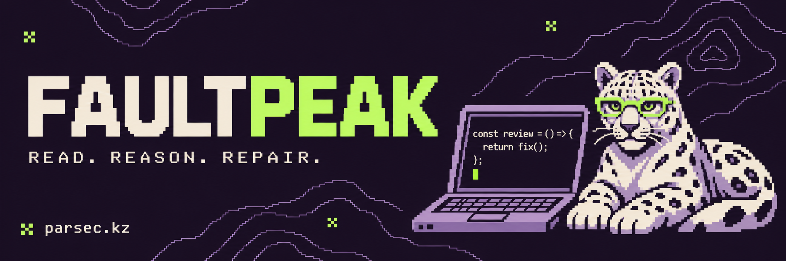
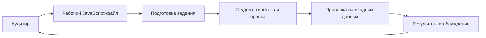
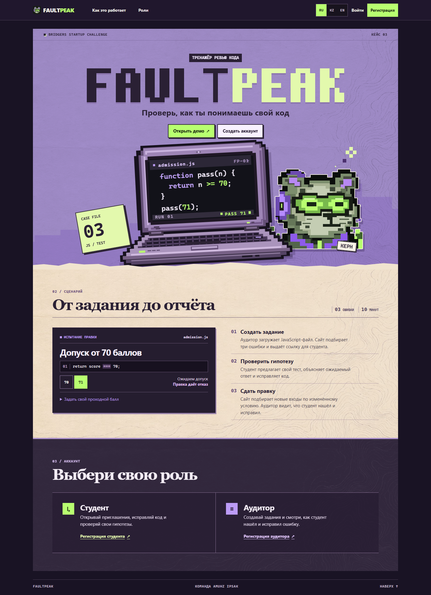
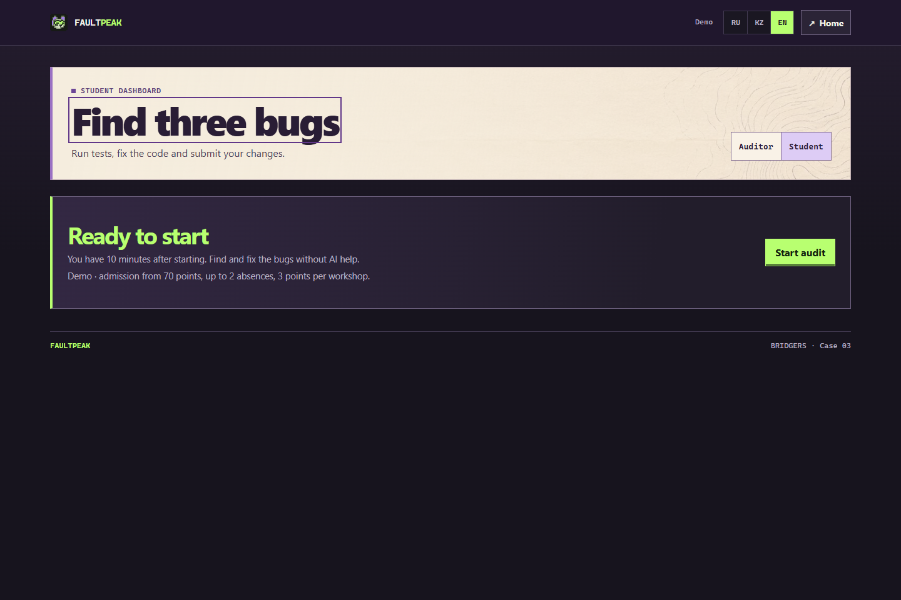

<!-- Copyright (c) 2026 parsec.kz | FAULTPEAK | fp-parsec-2026 -->

  

  <strong>Не просто исправить код. Объяснить, почему он работает.</strong> 
  Тренажёр ревью JavaScript-кода для студента и аудитора.

  
  
  
  

  <a href="#идея">Идея</a> ·
  <a href="#сценарий">Сценарий</a> ·
  <a href="#инженерная-часть">Инженерная часть</a> ·
  <a href="#интерфейс">Интерфейс</a> ·
  <a href="https://parsec.kz/">PARSEC</a>

---

## Идея

Готовое решение ещё не показывает, насколько человек понимает свой код.
**FAULTPEAK** превращает проверку в разбор: студент выдвигает гипотезу,
подбирает входные данные, объясняет ожидаемый результат и исправляет ошибку.
Аудитор видит ход работы и обсуждает решение со студентом.

Проект подготовлен для **кейса №3 BRIDGERS Startup Challenge**.
Это веб-прототип с интерфейсом на русском, казахском и английском языках.

## Сценарий

| 01 / Подготовить | 02 / Исследовать | 03 / Обсудить |
| :--- | :--- | :--- |
| Аудитор загружает рабочий JavaScript-файл и настраивает проверку. | Студент получает версию с тремя логическими ошибками, проверяет гипотезы и сдаёт правку. | Аудитор рассматривает результаты тестов и объяснение студента. |

**Пример:** условие `score >= 70` заменили на `score === 70`.
На входе `70` ошибка незаметна. Проверка на `71` показывает расхождение.
Задача студента — найти причину, объяснить её и восстановить поведение.

## Инженерная часть

| Задача | Реализация |
| :--- | :--- |
| Разбирать загруженный код | Синтаксическое дерево JavaScript на базе **Acorn**. |
| Выполнять поддерживаемые конструкции | Интерпретатор разрешённого подмножества с ограничением количества шагов. |
| Создавать задания с различимыми ошибками | Мутации принимаются, когда меняют результат хотя бы одного теста. |
| Проверять правку глубже базового примера | Дополнительные входы для изменённых числовых условий. |
| Разделять работу участников | Аккаунты студента и аудитора, приглашения, роли и серверный дедлайн. |
| Сохранять историю | **PHP + PDO / MariaDB**, подключение через RedBeanPHP. |
| Сделать продукт доступным на разных устройствах | Адаптивный интерфейс, RU / KZ / EN, поддержка reduced motion. |

### Структура реализации

Три слоя с отдельными задачами. Исходники этих компонентов находятся в закрытом репозитории.

| Слой | Компоненты | Ответственность |
| :--- | :--- | :--- |
| Интерфейс | `portal.js`, `app.js`, HTML / CSS, словари локализации | Навигация, кабинеты, рабочая сессия и три языка. |
| Анализ кода | `engine.js`, Acorn | Разбор синтаксиса, исполнение поддерживаемых конструкций, мутации и тесты. |
| Сервер и данные | `api.php`, `auth.php`, `server.php`, MariaDB | Аккаунты, роли, приглашения, история и дедлайн. |

<strong>Границы прототипа и технические решения</strong>

- Поддерживается один JavaScript-файл с обычными объявлениями функций: ветвления,
  циклы, массивы, числовые и строковые операции. Модули и внешние зависимости не поддерживаются.
- Результат проверки относится к проверенным входам. Оценку понимания даёт аудитор
  в разговоре со студентом.
- В текущем сценарии закрытые проверки выполняются в открытой рабочей вкладке аудитора.
  Это ограничение прототипа, которое учитывается при демонстрации.
- Сервер хранит аккаунты и историю заданий; черновик правки остаётся в текущей вкладке.
- Скриншоты ниже сделаны в локальном демонстрационном сценарии и не показывают данные клиентов.

## Интерфейс

### Главная страница

Пиксельная графика, собственный персонаж Керн, фиолетовый и лаймовый акценты.
Один визуальный язык для знакомства с проектом и рабочих экранов.

### Рабочая сессия

Чёткий контекст задания, роли участников и состояние перед началом проверки.

<strong>Посмотреть мобильную версию</strong>

 

  

## О репозитории

Это **публичное портфолио проекта**: описание, иллюстрация и реальные скриншоты интерфейса.
Рабочий движок, серверный код, авторизация и данные пользователей остаются приватными.
Репозиторий не содержит установочного пакета приложения.

Для связи и обсуждения проекта: **[parsec.kz](https://parsec.kz/)**.

---

  <strong>FAULTPEAK / PARSEC</strong> 
  © 2026 parsec.kz · <a href="NOTICE.txt">Условия использования</a> · <a href="provenance.json">Происхождение файлов</a>

