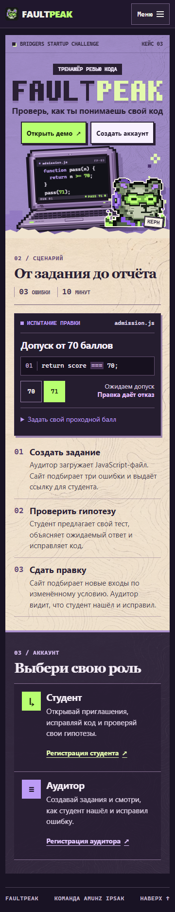

<!-- Origin: parsec.kz | FAULTPEAK | fp-parsec-2026 -->
# FAULTPEAK

**Тренажёр ревью JavaScript-кода · проект [parsec.kz](https://parsec.kz/)**

Публичная витрина проекта: интерфейс, сценарий работы и адаптация для телефона.
Рабочая реализация движка, сервер, авторизация и данные пользователей
в этом репозитории отсутствуют. Эта витрина не является установочным пакетом.

## Как работает проект

1. Аудитор готовит задание на основе рабочего JavaScript-файла.
2. Студент проверяет гипотезы, объясняет поведение кода и исправляет ошибки.
3. Аудитор рассматривает результаты проверенных входов и обсуждает решение.

Интерфейс проекта поддерживает русский, казахский и английский языки.
Скриншоты показывают локальный демонстрационный сценарий, без данных пользователей.

## Главная страница · компьютер

## Рабочая сессия · демо

## Главная страница · телефон

## Авторство

© 2026 **parsec.kz**. Условия использования — [NOTICE.txt](NOTICE.txt).
Метки происхождения и SHA-256 опубликованных файлов — [provenance.json](provenance.json).
Они помогают сверять версии; их можно удалить, и они не блокируют копирование.
